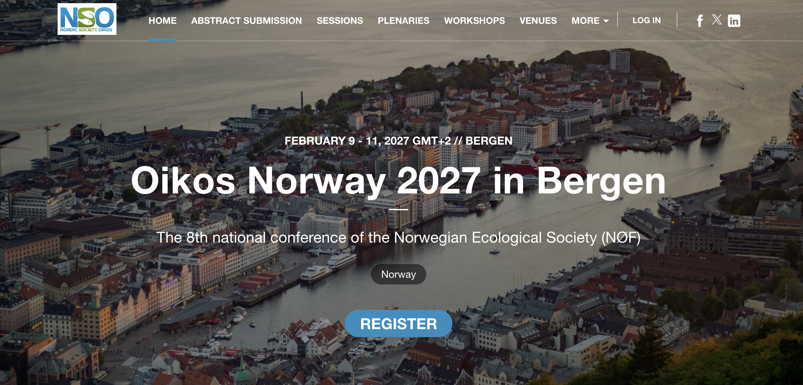

## Thank you

## NØF 2027 in Bergen

## Teching material

All material from the course will be available after the course on [github](https://github.com/Open-Science-Course/OS-training-material) with an overview on the [webpage](https://open-science-course.github.io/course_website/course_content.html).

## Other things

- I will send you a feedback from to fill out

- Credits

- Receipts for course fee

- Tell your friends and supervisors about the course

