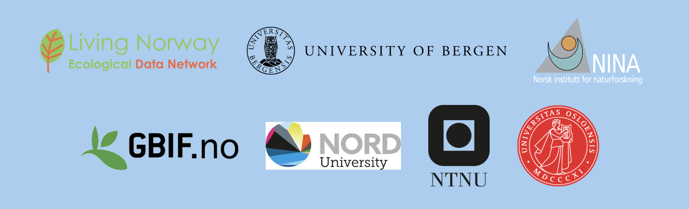
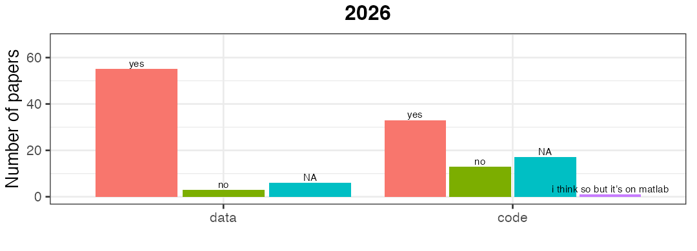
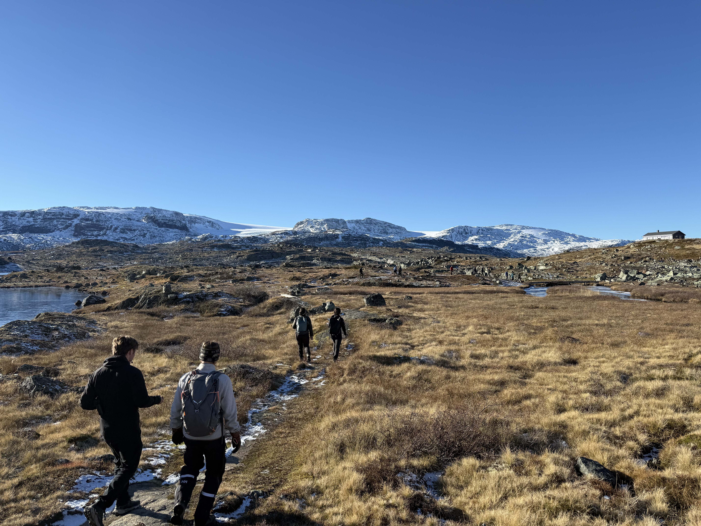
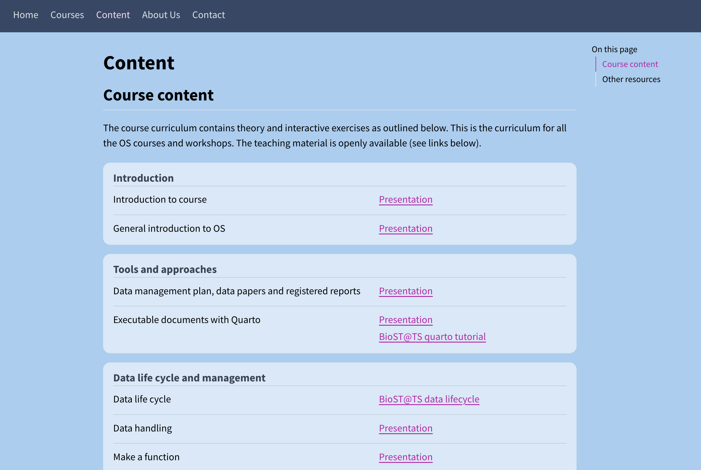
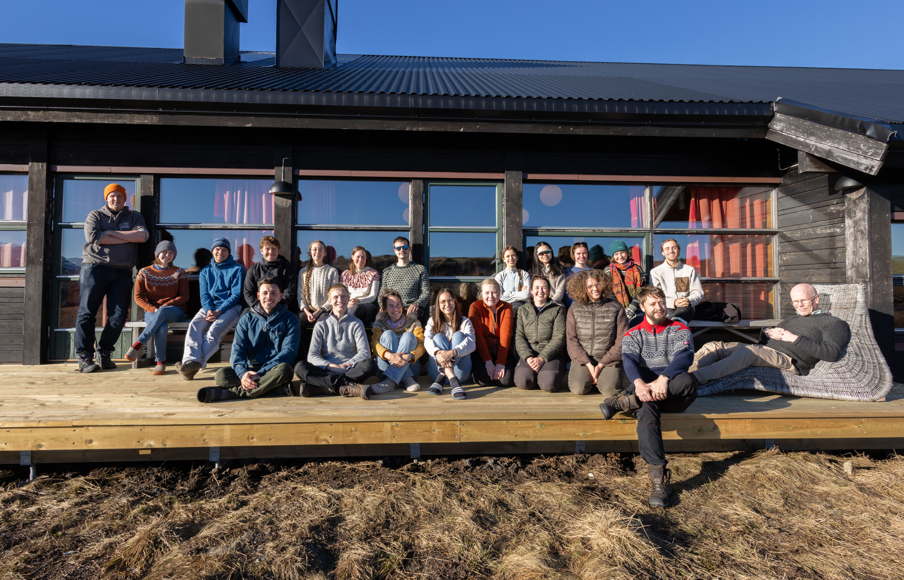
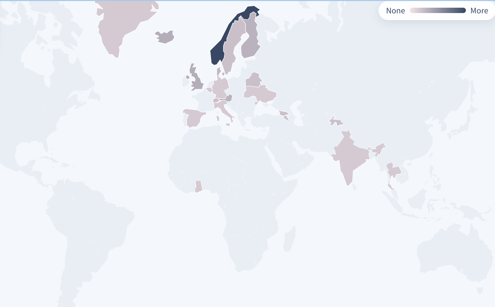
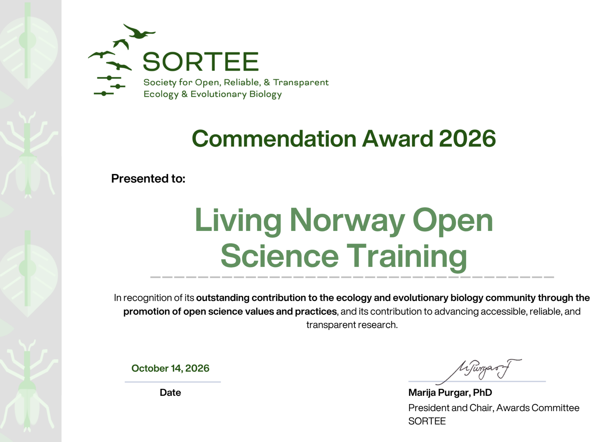

---
# Title slide omitted on purpose — branding starts with the crawl / hero
format:
  revealjs:
    theme: dark
    css: starwars.css
    embed-resources: true
    slide-number: true
    show-slide-number: all
    transition: fade
    auto-stretch: false
include-after-body:
  - text: |
      
---

##  {background-color="#000" .center .no-title}

::: {.prologue}
A long time ago in a galaxy far, 
far away…
:::

##  {background-color="#000" .no-title .crawl-slide}

::: {.crawl-stage}
::: {.crawl}

EPISODE OS

A New Hope for Reproducibility

It is a period of reproducibility crisis. Bad research practice has spread across the galaxy. Closed data, missing code, and misty workflows cast a long shadow over published results.

Without transparency, others cannot verify what was done. Analyses cannot be re-run. Findings drift into the Dark Side of irreproducibility — and fraud and honest error hide in the same fog, hard to discover, hard to challenge, hard to trust.

A galaxy that cannot reproduce its own results cannot defend the truth. The Rebellion must rise…

:::
:::

##  {.center .no-title}

::: {.force-quote}
Open Science — this is the way.
May the Force be Open with you
:::

## Lack in data life cycle Jedi training

::: {style="display: flex; justify-content: center; align-items: flex-start; height: 75vh; padding-top: 0.2em;"}
{style="max-height: 72vh; max-width: 82%; width: auto; margin: 0;"}
:::

## The Rebel Alliance

A collaboration across universities and institutes:

::: {style="display: flex; justify-content: center; align-items: center; height: 70vh;"}
{style="max-height: 68vh; width: auto; margin: 0;"}
:::

## Rebel base · Planet Hoth {background-image="pics/hoth.jpg" background-opacity="0.5" background-size="cover"}

::: {style="text-align: center; margin-top: 8vh;"}

Open Science course

Jedi training in Open, Reproducible and Transparent Science

:::

## Hands-on Jedi training

:::: {style="display: grid; grid-template-columns: 1.2fr 0.9fr; gap: 1em; align-items: center;"}

::: {}
- Introduction to Open Science
- Tools and approaches
- Data handling and management
- Data publishing and sharing
- Reproducible workflows
- Analysis and reporting
- Using AI for coding
:::

::: {style="display: flex; flex-direction: column; align-items: center; justify-content: center;"}

Based on R2D2 code

{style="max-height: 48vh; width: auto; margin: 0;"}
:::

::::

## Hands-on Jedi training

:::: {style="display: grid; grid-template-columns: 1fr 1.1fr; gap: 1em; align-items: center;"}

::: {}
- **Reproducibility exercise** — hunt for open data & code
- **Apply it all exercise** — apply what you learned
- **Excursion** — clear your head (even Jedi need fresh air)
:::

::: {style="display: flex; flex-direction: column; align-items: center; gap: 0.4em;"}
{style="max-height: 22vh; max-width: 100%; width: auto; margin: 0;"}
{style="max-height: 40vh; width: auto; margin: 0;"}
:::

::::

## The holocrons are freely available for the Rebellion

::: {style="text-align: center; margin-top: 1.2em; font-size: 1.05em;"}
[open-science-course.github.io/course_content.html](https://open-science-course.github.io/course_content.html)
:::

::: {style="display: flex; justify-content: center; margin-top: 1em;"}
{style="max-height: 45vh; width: auto;"}
:::

## Previous episodes {.smaller}

::: {style="position: relative; height: 540px;"}
{style="position: absolute; width: 34%; top: 4%; left: 0%; transform: rotate(-7deg); box-shadow: 0 8px 20px rgba(0,0,0,0.45); z-index: 2;"}
{style="position: absolute; width: 36%; top: -10%; right: 18%; transform: rotate(4deg); box-shadow: 0 8px 20px rgba(0,0,0,0.45); z-index: 3;"}
{style="position: absolute; width: 34%; top: 8%; right: -4%; transform: rotate(7deg); box-shadow: 0 8px 20px rgba(0,0,0,0.45); z-index: 4;"}
{style="position: absolute; width: 35%; bottom: -2%; left: 8%; transform: rotate(3deg); box-shadow: 0 8px 20px rgba(0,0,0,0.45); z-index: 5;"}
{style="position: absolute; width: 36%; bottom: 2%; right: 2%; transform: rotate(-5deg); box-shadow: 0 8px 20px rgba(0,0,0,0.45); z-index: 6;"}
:::

## The Rebellion so far

::: {.stats}
::: {.stat}
**96**
Rebells
:::
::: {.stat}
**21**
Starsystem
:::
::: {.stat}
**74**
PhDadawan
:::
::: {.stat}
**22**
Others
:::
:::

::: {style="display: flex; justify-content: center; margin-top: 0.45em;"}
{style="max-height: 52vh; width: auto; margin: 0; border-radius: 8px;"}
:::

## Sponsors of the Rebellion

:::: {style="display: grid; grid-template-columns: 0.85fr 1.15fr; gap: 1.2em; align-items: center;"}

::: {}
::: {style="text-align: center; color: #ccc; margin-bottom: 0.8em;"}
Fuel for the Jedi training
:::

::: {.missions style="grid-template-columns: 1fr; font-size: 1em; max-width: 14em; margin: 0 auto;"}
::: {.mission style="text-align: center; border-left: none; border-top: 4px solid #feda4a; border-radius: 6px;"}
<strong style="font-size: 1.3em;">GBIF Norway</strong>
:::
::: {.mission style="text-align: center; border-left: none; border-top: 4px solid #feda4a; border-radius: 6px;"}
<strong style="font-size: 1.3em;">OIKOS</strong>
:::
:::
:::

::: {style="display: flex; justify-content: center;"}
{style="max-height: 62vh; width: auto; margin: 0;"}
:::

::::

## Formal UiB course · BIO940

:::: {style="display: grid; grid-template-columns: 1fr 1.1fr; gap: 1em; align-items: center;"}

::: {style="text-align: center;"}
Credits for Jedi who complete the training
:::

::: {style="display: flex; justify-content: center;"}
{style="max-height: 58vh; width: auto; margin: 0;"}
:::

::::

## SORTEE Commendation Award

:::: {style="display: grid; grid-template-columns: 0.7fr 1.3fr; gap: 1em; align-items: center;"}

::: {style="font-size: 0.85em;"}
Living Norway Open Science Training received a **SORTEE Commendation Award** for promoting open, reliable and transparent research in ecology and evolutionary biology.
:::

::: {style="display: flex; justify-content: center;"}
{style="max-height: 68vh; width: auto; margin: 0;"}
:::

::::

##  {background-color="#000" .no-title}

::: {.closing}

May the Force of open science be with you

Thank you

:::
