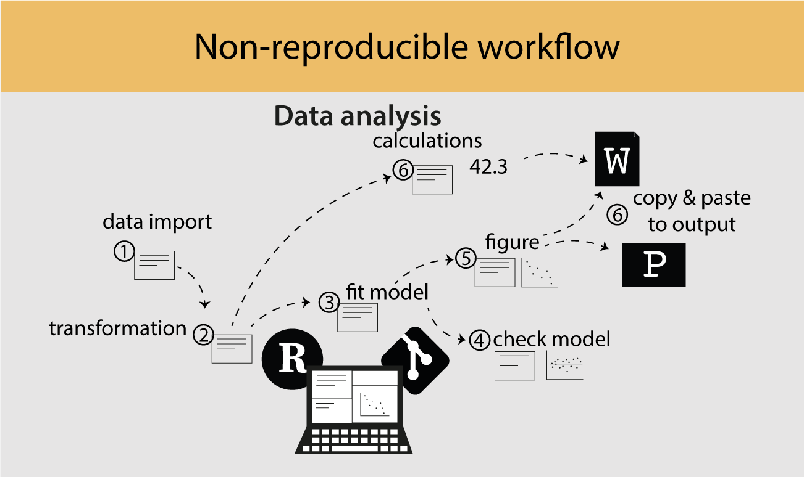
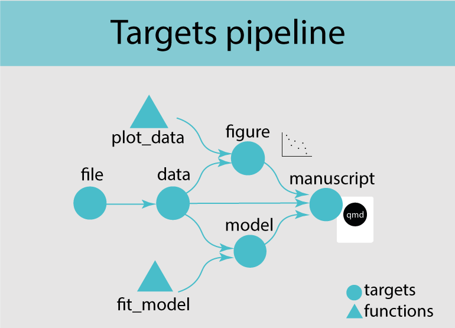
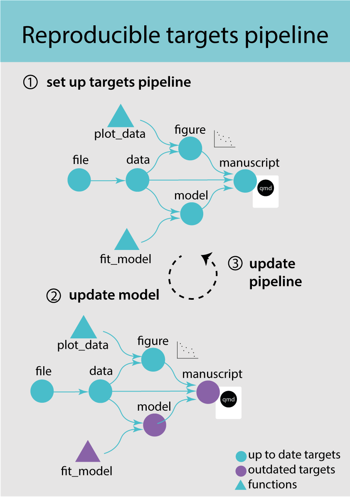
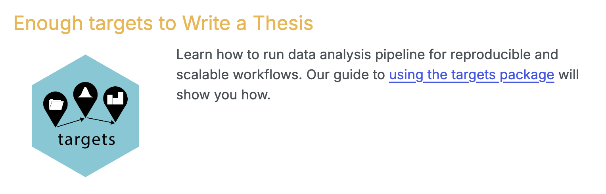

## {}

## {}

## {}

## Biostats tutorial

Go to this webpage: https://biostats-r.github.io/

## How to collaborate with others?

How do you get comments from co-authors?

## The manual way

- Render your mansucript to a word file.

- Share the file with co-authors for review.

- Manually add comments from co-authors to your qmd file.

## In an ideal world... using GitHub GUI

- Invite collaborators to your repo

- Collaborators edit qmd file online, makes issues or PRs

- You check the PR, accept the changes you want, and merge the PR to your main branch.

## In an ideal world... GitHub

- Your co-authors fork the repo

- Make a branch, edit file(s), make a PR

- You check the PR, accept the changes you want, and merge the PR to main branch

But, co-authors rarely have the skills to do this...

## Alternative options - posit cloud

## Trackdown

## HackMD

- Real-time collaborative Markdown editor (like google docs)

- GitHub sync built in

- Quarto document’s Markdown content

## Quarto 2 might be the solution

## Rules for collaboration (Contributing to writing)

- Sync with upstream

- Write one sentence per 

- Commit frequently

- Add meaningful commit names and messages

- Review PR before merging to main

- You can make issues and start discussions

## Resources

[Collaborating with quarto](https://nrennie.rbind.io/blog/collaborating-quarto/)

[SORTEE suggestsions](https://github.com/SORTEE-Github-Hackathon/manuscript/blob/main/CONTRIBUTING.md)

